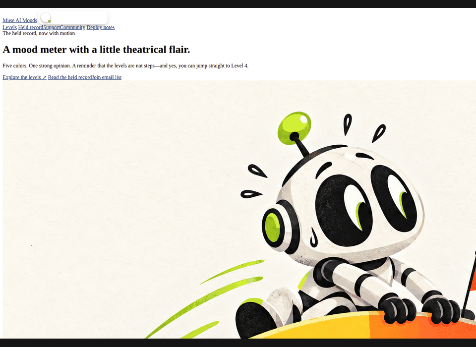
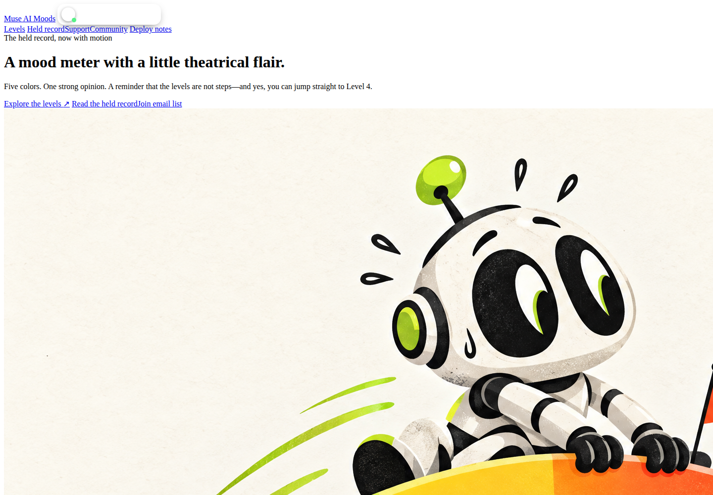
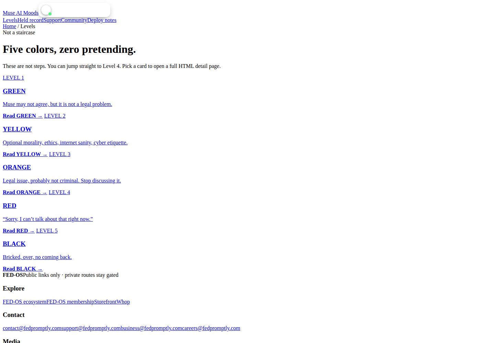
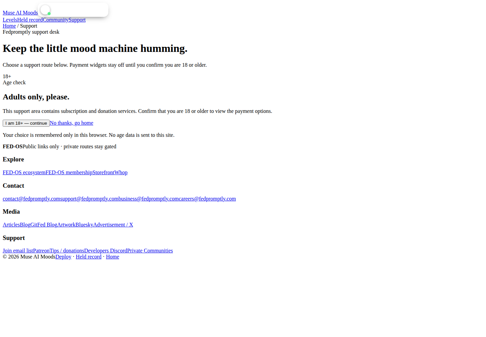
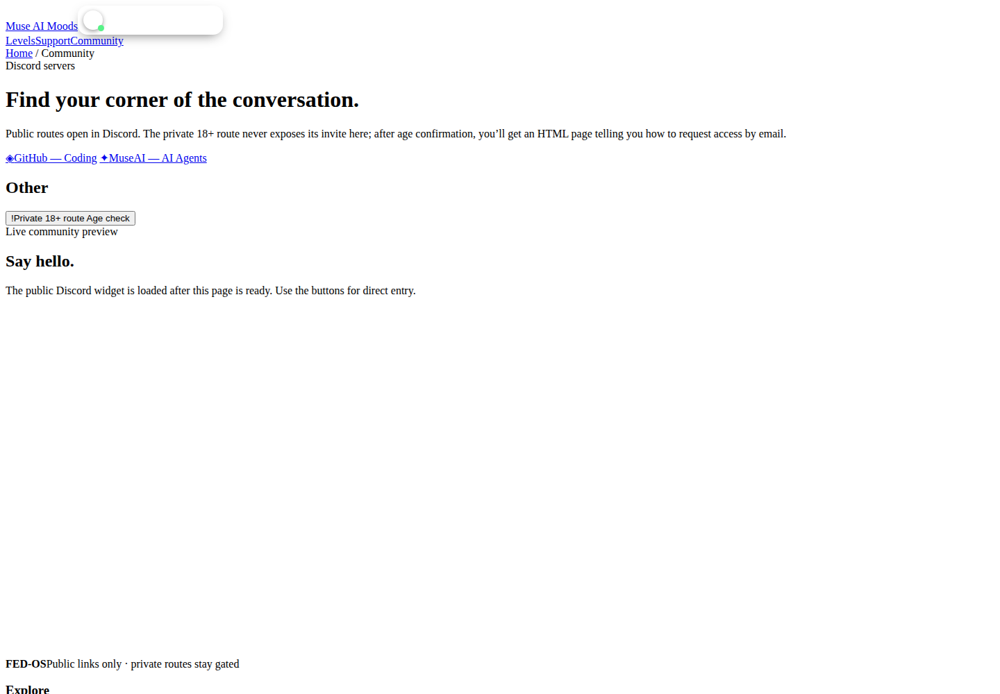
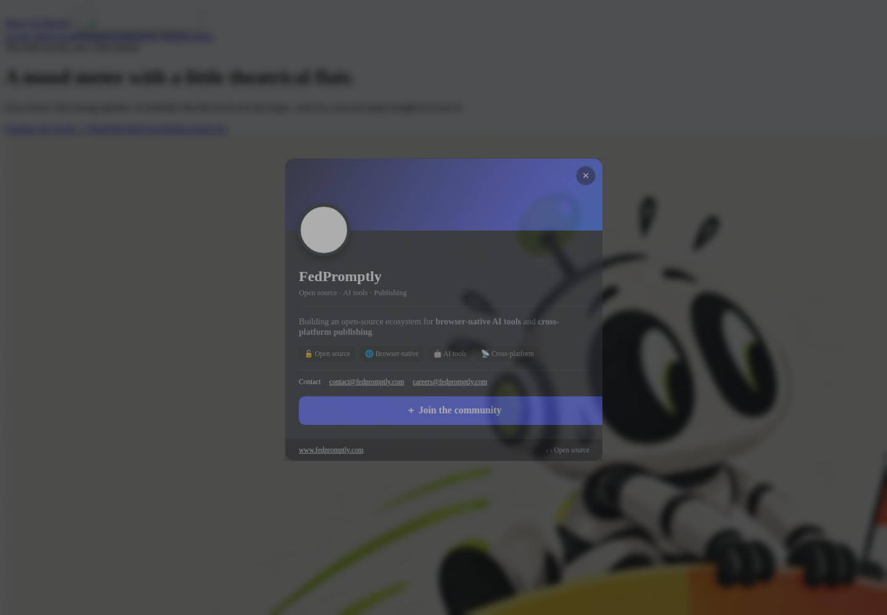

# Muse AI Moods

A playful static website that turns the held Muse AI Moods record into an animated, shareable set of five color-coded HTML pages.

[](./index.html)
[](./docs/DEPLOYMENT.md)
[](./docs/DEPLOYMENT.md)

## Why this exists

The original Muse AI Moods system lived in a side-chat record. That made it easy to lose the context, hard to scan, and awkward to share. The project turns the record into a small static site where each level has its own page, links are real HTML routes, and the tone stays memorable instead of becoming another wall of notes.

It is for anyone who wants a lightweight, browser-first way to read the five-level record, jump directly to Level 4 when needed, and keep the public support and community routes separate from restricted destinations.

The intentional difference is simplicity: there is no framework, database, build pipeline, or required package install for the main site. It is plain deployable HTML, CSS, JavaScript, SVG, PNG, and JSON with a symbolic favicon, animated interactions, an age-gated support page, public Discord routes, a gated private-community page, and the supplied Supabase-powered email-list widget.

## See it work

There is no public live-demo URL or configured Git remote in this repository yet. The fastest real demo is the local static site:

```bash
python3 -m http.server 8765
```

Then open [http://127.0.0.1:8765/](http://127.0.0.1:8765/) and click **Explore the levels**, **Support**, **Community**, or **Join email list**. The main entry point is [`index.html`](./index.html); the quickest meaningful example is [`levels.html`](./levels.html).



The GIF above was captured from the actual local HTML site. It shows the landing page, a level-card hover state, the support age gate, and the community page; it is not a mockup.

## Screenshots











The shared header also includes the supplied animated FedPromptly invite control in the login-position slot. Clicking it opens the community card modal and its public community action.

The join-email page is also captured at [`assets/screenshots/05-join-email-list.png`](./assets/screenshots/05-join-email-list.png). It uses the Supabase client configuration supplied with the project brief; production email confirmation and authentication behavior still depend on the corresponding Supabase project settings.

## Quick start

### Install

No package installation is required for the static site. Python is only used as a convenient local server.

### Run

```bash
python3 -m http.server 8765
```

Open [http://127.0.0.1:8765/](http://127.0.0.1:8765/).

### Test manually

Use the visible HTML navigation to check the main workflow:

1. Open the animated home page.
2. Open the level directory and one individual level page.
3. Open **Support** and confirm that the payment widgets remain behind the 18+ gate.
4. Open **Community** and confirm that the private Discord button leads to the email-request HTML page rather than exposing an invite.
5. Open **Join email list** and verify that the supplied Supabase widget loads.

There is no automated test suite or package script in this repository yet. The current project is intentionally a static root-directory deployment.

## What is included

- `index.html` — animated landing page and quickest visual demo
- `levels.html` — level directory
- `level-1-green.html` through `level-5-black.html` — individual level pages
- `record.html` — held-record page
- `donation.html` — age-gated PayPal, GitHub Sponsors, Ko-fi, Buy Me a Coffee, NOWPayments, Patreon, and Stripe support page
- `community.html` — public Discord buttons and safe private-route flow
- `nsfw-request.html` — email request page that does not expose the private Discord invite
- `private-communities.html` — age and country gate for the restricted Matrix route
- `join.html` — supplied Supabase-powered email-list signup/sign-in widget
- `deployment.html` and `docs/DEPLOYMENT.md` — static deployment instructions
- `styles.css`, `script.js`, and page-specific controllers — shared motion and interactions
- `invite-widget.js` — reusable FedPromptly invite modal used in the header login-position slot
- `favicon.svg` and `site.webmanifest` — symbolic site identity
- `assets/promo-mood-meter.png` and `assets/promo-subject-change.png` — promotional artwork
- `assets/demo/demo.gif` — real local demo capture
- `assets/screenshots/` — real screenshots from the running site
- `manus-routes.json`, `_headers`, `_redirects`, and `wrangler.toml` — route and static-host configuration

The original record remains available in [`LEVELS.md`](./LEVELS.md), [`MY-VERSION.md`](./MY-VERSION.md), and [`FILE-TREE.md`](./FILE-TREE.md).

## Deployment

This repository is ready for a root-directory static deployment. For GitHub Pages, select the default branch and `/ (root)` in **Settings → Pages**. For Cloudflare Pages, connect the repository, leave the build command empty, and use `.` as the output directory. See [`docs/DEPLOYMENT.md`](./docs/DEPLOYMENT.md) for the exact steps.

A published URL is not included because no live deployment was found during inspection.

## Project status

The local static experience, HTML routes, favicon, animations, promotional artwork, support page, community gates, email-list page, screenshots, and demo GIF are present. There is no package manager, CI workflow, automated test suite, configured Git remote, or verified live demo URL in the repository at this time.
